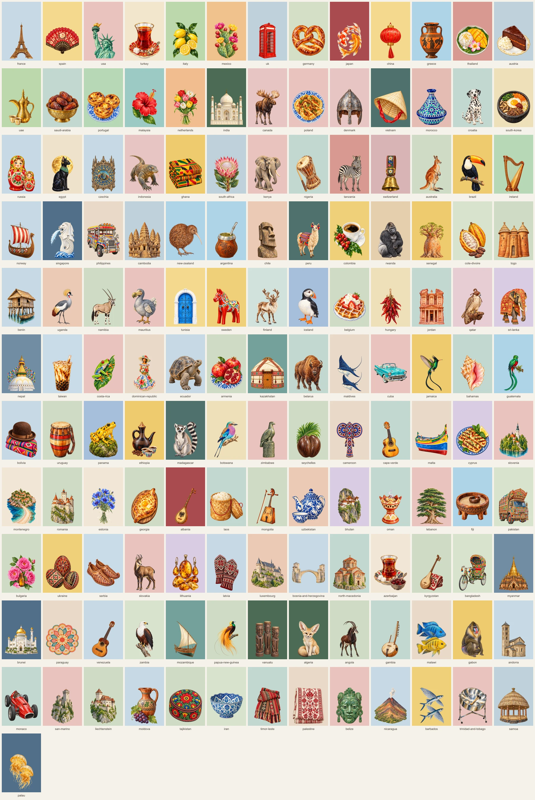

# Flat object covers

Current direction for the 144-country cover library. The earlier scenic poster series is archived.



The album builder and printed PDF use dedicated 4:5 artwork with space above the subject for the title and a safe margin around every edge. [Review all 144 print covers at their actual proportions](./flat-object-print-covers-contact-sheet.webp).

[Review the latest 20 print covers at a larger size](./flat-object-new-20-print-covers.webp).

Each cover is one solid, carefully paired background colour with a single painted object associated with the country: a food, animal, craft, vehicle or building. The look is soft gouache/watercolour realism, as on the Armenia (pomegranates), Kazakhstan (yurt), Egypt (Bastet cat and moon), Maldives (manta rays) and Thailand (mango sticky rice) reference books.

The backgrounds use a restrained palette of powder blues, sea glass, rose, sage and warm paper, chosen against each painted subject so both the art and cover title stay clear. The artwork has no lettering. The app renders the country name and year in the customer's chosen typeface and colour, so the top 30% stays plain background. Keep each background hex in this table and `src/lib/travel-covers.ts` in sync.

## Shared prompt

Every prompt in [flat-object-cover-prompts.md](./flat-object-cover-prompts.md) uses the same painted-subject brief. The table supplies the final background colour to the compositor.

```text
Portrait 2:3, 1024x1536, isolated subject artwork for a travel photo album cover.
Background: actual transparent alpha. No gradient, texture, scenery, floor, horizon, shadow or glow. The solid cover colour is applied during composition.
Subject: {object}. A single hand-painted illustration in soft gouache and watercolour realism, with gentle tonal shading, crisp clean edges, rich natural colour and fine authentic detail. The style is like a premium illustrated cookbook or museum print. It is not photographic, not 3D, not vector clipart and not cartoonish.
Composition: centre the complete subject, large and confident, with transparent margin on every side. Do not crop any part. The composer positions the subject below the title in both cover shapes.
Do not include any text, letters, numbers, logos, flags, watermarks, borders, frames, book mockups, spines or perspective distortion.
```

## Library

| # | Country | Main object | Alternate | Background | Default title ink |
|---|---|---|---|---|---|
| 1 | France | Eiffel Tower | Butter croissant | Powder Blue `#C7D9E6` | Auto |
| 2 | Spain | Open red flamenco fan | Paella pan | Sea Glass `#C2D8D1` | Auto |
| 3 | United States | Statue of Liberty torch and crown | Golden Gate tower | Soft Rose `#E8C3BE` | Auto |
| 4 | Türkiye | Tulip glass of tea on a saucer | Cappadocia hot-air balloon | Warm Ivory `#F1E7D6` | Auto |
| 5 | Italy | Sliced lemons with leaves | Vespa scooter | Powder Blue `#C7D9E6` | Auto |
| 6 | Mexico | Prickly-pear cactus in bloom | Sugar skull | Warm Sand `#E5D0AD` | Auto |
| 7 | United Kingdom | Red telephone box | Royal Guard bearskin hat | Misty Blue `#BDD1DB` | Auto |
| 8 | Germany | Pretzel | Cuckoo clock | Pale Sage `#CEDCC4` | Auto |
| 9 | Japan | Pair of koi fish | Torii gate | Deep Slate Blue `#526F89` | Auto |
| 10 | China | Red paper lantern | Giant panda | Muted Teal `#75A19B` | Auto |
| 11 | Greece | Black-figure amphora | Blue-domed chapel | Powder Blue `#C7D9E6` | Auto |
| 12 | Thailand | Mango sticky rice with a frangipani flower | Tuk-tuk | Dusty Rose `#DAAAA7` | Auto |
| 13 | Austria | Slice of Sachertorte | Lipizzaner horse | Misty Blue `#BDD1DB` | Auto |
| 14 | UAE | Brass dallah (coffee pot) | Falcon | Powder Blue `#C7D9E6` | Auto |
| 15 | Saudi Arabia | Bowl of Medjool dates | Arabian horse | Sea Glass `#C2D8D1` | Auto |
| 16 | Portugal | Pastéis de nata | Barcelos rooster | Deep Slate Blue `#526F89` | Auto |
| 17 | Malaysia | Red hibiscus flower | Rhinoceros hornbill | Warm Sand `#E5D0AD` | Auto |
| 18 | Netherlands | Bunch of tulips | Windmill | Powder Blue `#C7D9E6` | Auto |
| 19 | India | Taj Mahal | Brass chai set | Slate Blue `#708DA3` | Auto |
| 20 | Canada | Moose | Jar of maple syrup | Powder Blue `#C7D9E6` | Auto |
| 21 | Poland | Plate of pierogi | Wawel dragon | Soft Rose `#E8C3BE` | Auto |
| 22 | Denmark | Little Mermaid statue | Viking helmet | Warm Ivory `#F1E7D6` | Auto |
| 23 | Vietnam | Conical hat (nón lá) | Phin coffee filter | Deep Teal `#4E716D` | Auto |
| 24 | Morocco | Painted tagine pot | Babouche slippers | Soft Peach `#EBCBB5` | Auto |
| 25 | Croatia | Dalmatian dog | Dubrovnik tower | Sea Glass `#C2D8D1` | Auto |
| 26 | South Korea | Bibimbap in a stone bowl | Pagoda roof | Soft Butter `#EEDFB9` | Auto |
| 27 | Russia | Matryoshka doll | St Basil's domes | Powder Blue `#C7D9E6` | Auto |
| 28 | Egypt | Bastet cat in front of a moon | Pyramid | Sage Green `#AEC8B4` | Auto |
| 29 | Czechia | Prague astronomical clock | Glass of pilsner | Powder Blue `#C7D9E6` | Auto |
| 30 | Indonesia | Komodo dragon | Balinese offering basket | Pale Lilac `#D9CCE3` | Auto |
| 31 | Ghana | Folded kente cloth | Talking drum | Soft Linen `#E8D9C7` | Auto |
| 32 | South Africa | King protea flower | African penguin | Misty Blue `#BDD1DB` | Auto |
| 33 | Kenya | Elephant | Maasai beaded collar | Soft Rose `#E8C3BE` | Auto |
| 34 | Nigeria | Talking drum (dùndún) | Jollof rice with plantain | Sea Glass `#C2D8D1` | Auto |
| 35 | Tanzania | Zebra | Kilimanjaro | Dusty Rose `#DAAAA7` | Auto |
| 36 | Switzerland | Cowbell on a flowered strap | Matterhorn | Slate Blue `#708DA3` | Auto |
| 37 | Australia | Kangaroo | Koala | Pale Sage `#CEDCC4` | Auto |
| 38 | Brazil | Toucan | Christ the Redeemer | Soft Rose `#E8C3BE` | Auto |
| 39 | Ireland | Celtic harp | Connemara sheep | Slate Blue `#708DA3` | Auto |
| 40 | Norway | Viking longship | Stave church | Powder Blue `#C7D9E6` | Auto |
| 41 | Singapore | Merlion | Orchid | Deep Slate Blue `#526F89` | Auto |
| 42 | Philippines | Jeepney | Mango | Soft Linen `#E8D9C7` | Auto |
| 43 | Cambodia | Angkor Wat towers | Lotus | Misty Blue `#BDD1DB` | Auto |
| 44 | New Zealand | Kiwi bird | Pavlova | Pale Sage `#CEDCC4` | Auto |
| 45 | Argentina | Mate gourd with metal straw | Tango shoes | Pale Lilac `#D9CCE3` | Auto |
| 46 | Chile | Moai head | Copihue flower | Soft Peach `#EBCBB5` | Auto |
| 47 | Peru | Llama | Machu Picchu | Deep Teal `#4E716D` | Auto |
| 48 | Colombia | Coffee cherries and cup | Sombrero vueltiao (woven hat) | Soft Linen `#E8D9C7` | Auto |
| 49 | Rwanda | Mountain gorilla | Agaseke basket | Soft Peach `#EBCBB5` | Auto |
| 50 | Senegal | Baobab tree | Painted pirogue (boat) | Sea Glass `#C2D8D1` | Auto |
| 51 | Côte d'Ivoire | Split cocoa pod | Baoulé mask | Pale Lilac `#D9CCE3` | Auto |
| 52 | Togo | Tamberma mud tower-house | Pineapple | Pale Sage `#CEDCC4` | Auto |
| 53 | Benin | Ganvié stilt house with canoe | Fon appliqué banner | Powder Blue `#C7D9E6` | Auto |
| 54 | Uganda | Grey crowned crane | Matooke bananas | Soft Peach `#EBCBB5` | Auto |
| 55 | Namibia | Gemsbok (oryx) | Deadvlei camel-thorn tree | Pale Sage `#CEDCC4` | Auto |
| 56 | Mauritius | Dodo | Sugarcane | Soft Rose `#E8C3BE` | Auto |
| 57 | Tunisia | Blue Sidi Bou Said door | Wire birdcage | Warm Ivory `#F1E7D6` | Auto |
| 58 | Sweden | Dala horse | Cinnamon bun | Powder Blue `#C7D9E6` | Auto |
| 59 | Finland | Reindeer | Sauna bucket and ladle | Pale Aqua `#D0E1DC` | Auto |
| 60 | Iceland | Puffin | Icelandic horse | Cornflower `#A5BFDA` | Auto |
| 61 | Belgium | Waffle with strawberries | Cone of frites | Pale Sage `#CEDCC4` | Auto |
| 62 | Hungary | String of red paprika | Herend porcelain cup | Soft Butter `#EEDFB9` | Auto |
| 63 | Jordan | Petra Treasury | Dead Sea salt crystals | Sea Glass `#C2D8D1` | Auto |
| 64 | Qatar | Falcon on a leather glove | Dhow boat | Pale Lilac `#D9CCE3` | Auto |
| 65 | Sri Lanka | Elephant | Cup of Ceylon tea | Pale Lilac `#D9CCE3` | Auto |
| 66 | Nepal | Boudhanath stupa | Momo dumplings | Slate Blue `#708DA3` | Auto |
| 67 | Taiwan | Bubble tea | Sky lantern | Pale Sage `#CEDCC4` | Auto |
| 68 | Costa Rica | Red-eyed tree frog | Painted oxcart wheel | Soft Rose `#E8C3BE` | Auto |
| 69 | Dominican Republic | Faceless Limé doll | Güira and tambora drum | Soft Linen `#E8D9C7` | Auto |
| 70 | Ecuador | Galápagos tortoise | Toquilla straw hat (the "Panama hat") | Powder Blue `#C7D9E6` | Auto |
| 71 | Armenia | Pomegranates on a plate | Duduk flute | Pale Sage `#CEDCC4` | Auto |
| 72 | Kazakhstan | Yurt | Golden eagle | Muted Teal `#75A19B` | Auto |
| 73 | Belarus | Bison | Straw-woven doll | Sea Glass `#C2D8D1` | Auto |
| 74 | Maldives | Spotted eagle rays | Dhoni boat | Soft Linen `#E8D9C7` | Auto |
| 75 | Cuba | 1950s convertible car | Maracas | Soft Rose `#E8C3BE` | Auto |
| 76 | Jamaica | Doctor bird hummingbird | Ackee fruit | Soft Peach `#EBCBB5` | Auto |
| 77 | Bahamas | Queen conch shell | Flamingo | Sea Glass `#C2D8D1` | Auto |
| 78 | Guatemala | Resplendent quetzal | Woven huipil textile | Pale Lilac `#D9CCE3` | Auto |
| 79 | Bolivia | Cholita bowler hat on an aguayo weaving | Andean flamingo | Powder Blue `#C7D9E6` | Auto |
| 80 | Uruguay | Candombe tamboril drum | Chivito sandwich | Pale Sage `#CEDCC4` | Auto |
| 81 | Panama | Panamanian golden frog | Mola textile panel | Cornflower `#A5BFDA` | Auto |
| 82 | Ethiopia | Jebena coffee pot with cups | Lalibela rock church | Pale Lilac `#D9CCE3` | Auto |
| 83 | Madagascar | Ring-tailed lemur | Panther chameleon | Deep Teal `#4E716D` | Auto |
| 84 | Botswana | Lilac-breasted roller | Mokoro canoe | Soft Butter `#EEDFB9` | Auto |
| 85 | Zimbabwe | Great Zimbabwe soapstone bird | Victoria Falls | Soft Rose `#E8C3BE` | Auto |
| 86 | Seychelles | Coco de mer nut | Fairy tern | Pale Sage `#CEDCC4` | Auto |
| 87 | Cameroon | Bamileke beaded elephant mask | Pineapple | Soft Linen `#E8D9C7` | Auto |
| 88 | Cape Verde | Cavaquinho guitar | Pot of cachupa | Sea Glass `#C2D8D1` | Auto |
| 89 | Malta | Luzzu fishing boat | Maltese balcony | Soft Linen `#E8D9C7` | Auto |
| 90 | Cyprus | Grilled halloumi with mint | Mouflon | Pale Lilac `#D9CCE3` | Auto |
| 91 | Slovenia | Lake Bled island church | Slice of potica | Soft Rose `#E8C3BE` | Auto |
| 92 | Montenegro | Sveti Stefan island village | Bowl of figs | Warm Ivory `#F1E7D6` | Auto |
| 93 | Romania | Bran Castle | Painted Easter egg | Pale Sage `#CEDCC4` | Auto |
| 94 | Estonia | Bunch of cornflowers | Kiek in de Kök tower | Warm Ivory `#F1E7D6` | Auto |
| 95 | Georgia | Adjarian khachapuri | Qvevri wine jar | Pale Sage `#CEDCC4` | Auto |
| 96 | Albania | Çifteli lute | Qeleshe felt cap | Sea Glass `#C2D8D1` | Auto |
| 97 | Laos | Bamboo sticky-rice basket | That Luang stupa | Sea Glass `#C2D8D1` | Auto |
| 98 | Mongolia | Morin khuur (horse-head fiddle) | Bactrian camel | Pale Sage `#CEDCC4` | Auto |
| 99 | Uzbekistan | Blue-and-white cotton-pattern teapot | Samarkand dome | Soft Peach `#EBCBB5` | Auto |
| 100 | Bhutan | Tiger's Nest monastery | Takin | Pale Lilac `#D9CCE3` | Auto |
| 101 | Oman | Frankincense burner | Khanjar dagger | Sea Glass `#C2D8D1` | Auto |
| 102 | Lebanon | Cedar tree | Manakish flatbread | Soft Rose `#E8C3BE` | Auto |
| 103 | Fiji | Carved tanoa kava bowl | Drua canoe | Pale Lilac `#D9CCE3` | Auto |
| 104 | Pakistan | Decorated truck | Cup of chai | Soft Linen `#E8D9C7` | Auto |
| 105 | Bulgaria | Bulgarian Damask roses and a rose-oil vial | Rila Monastery | Pale Sage `#CEDCC4` | Auto |
| 106 | Ukraine | Three patterned pysanky eggs | Sunflower bouquet | Powder Blue `#C7D9E6` | Auto |
| 107 | Serbia | Pair of opanak leather shoes | Šajkača cap | Sea Glass `#C2D8D1` | Auto |
| 108 | Slovakia | Tatra chamois | Čičmany house | Soft Rose `#E8C3BE` | Auto |
| 109 | Lithuania | Baltic amber jewelry | Gediminas Tower | Pale Lilac `#D9CCE3` | Auto |
| 110 | Latvia | Patterned wool mittens | Riga Art Nouveau facade | Powder Blue `#C7D9E6` | Auto |
| 111 | Luxembourg | Vianden Castle | Adolphe Bridge | Soft Peach `#EBCBB5` | Auto |
| 112 | Bosnia and Herzegovina | Stari Most bridge | Copper coffee set | Powder Blue `#C7D9E6` | Auto |
| 113 | North Macedonia | Church of St John at Kaneo | Ohrid pearls | Sea Glass `#C2D8D1` | Auto |
| 114 | Azerbaijan | Armudu tea glass with cherry jam | Maiden Tower | Warm Ivory `#F1E7D6` | Auto |
| 115 | Kyrgyzstan | Komuz lute and shyrdak felt | Yurt | Pale Sage `#CEDCC4` | Auto |
| 116 | Bangladesh | Painted Dhaka rickshaw | Shapla water lily | Soft Linen `#E8D9C7` | Auto |
| 117 | Myanmar | Bagan temple pagoda | Lacquerware bowl | Slate Blue `#708DA3` | Auto |
| 118 | Brunei | Sultan Omar Ali Saifuddien Mosque | Proboscis monkey | Deep Slate Blue `#526F89` | Auto |
| 119 | Paraguay | Ñandutí lace circle | Tereré cup | Soft Linen `#E8D9C7` | Auto |
| 120 | Venezuela | Four-string cuatro | Angel Falls | Powder Blue `#C7D9E6` | Auto |
| 121 | Zambia | African fish eagle | Victoria Falls | Dusty Rose `#DAAAA7` | Auto |
| 122 | Mozambique | Dhow sailboat | Capulana textile | Muted Teal `#75A19B` | Auto |
| 123 | Papua New Guinea | Bird of paradise | Bilum woven bag | Pale Sage `#CEDCC4` | Auto |
| 124 | Vanuatu | Three carved tamtam slit drums | Outrigger canoe | Powder Blue `#C7D9E6` | Auto |
| 125 | Algeria | Fennec fox | Saharan teapot | Powder Blue `#C7D9E6` | Auto |
| 126 | Angola | Giant sable antelope | Kissama baobab | Pale Sage `#CEDCC4` | Auto |
| 127 | The Gambia | Kora harp | Painted fishing pirogue | Sea Glass `#C2D8D1` | Auto |
| 128 | Malawi | Lake Malawi cichlids | Mulanje tea leaves | Soft Linen `#E8D9C7` | Auto |
| 129 | Gabon | Mandrill | Forest elephant | Soft Peach `#EBCBB5` | Auto |
| 130 | Andorra | Sant Joan de Caselles church | Pyrenean wildflower | Powder Blue `#C7D9E6` | Auto |
| 131 | Monaco | Grand Prix racing car | Monte Carlo casino | Sea Glass `#C2D8D1` | Auto |
| 132 | San Marino | Guaita fortress tower | Three Towers | Soft Rose `#E8C3BE` | Auto |
| 133 | Liechtenstein | Vaduz Castle | Alpine ibex | Pale Sage `#CEDCC4` | Auto |
| 134 | Moldova | Clay wine jug and grapes | Traditional woven rug | Powder Blue `#C7D9E6` | Auto |
| 135 | Tajikistan | Chakan embroidered cap | Pamir mountains | Pale Sage `#CEDCC4` | Auto |
| 136 | Iran | Persian ceramic bowl | Pomegranate | Soft Peach `#EBCBB5` | Auto |
| 137 | Timor-Leste | Tais woven textile | Atauro pottery | Sea Glass `#C2D8D1` | Auto |
| 138 | Palestine | Tatreez embroidered textile | Olive branch | Soft Linen `#E8D9C7` | Auto |
| 139 | Belize | Maya jade mask | Keel-billed toucan | Soft Rose `#E8C3BE` | Auto |
| 140 | Nicaragua | Momotombo volcano | Painted ceramic bowl | Powder Blue `#C7D9E6` | Auto |
| 141 | Barbados | Flying fish | Coral shell | Soft Peach `#EBCBB5` | Auto |
| 142 | Trinidad and Tobago | Steelpan drum | Scarlet ibis | Soft Rose `#E8C3BE` | Auto |
| 143 | Samoa | Traditional fale house | Siapo barkcloth | Misty Blue `#BDD1DB` | Auto |
| 144 | Palau | Golden jellyfish | Rock Islands | Deep Slate Blue `#526F89` | Auto |

All 144 destinations are listed in `src/lib/travel-covers.ts` and have finished artwork, thumbnails, and landing-page variants.

## Generating

Ready-to-paste ChatGPT prompts for every row, with the generation steps, are in [flat-object-cover-prompts.md](./flat-object-cover-prompts.md).

Save newly generated transparent PNGs with `node scripts/archive-flat-cover-cutouts.mjs <png-directory>`. Rebuild the artwork with `node scripts/compose-flat-cover-art.mjs assets/album-cover-cutouts` after changing background colours or scale. This writes both 2:3 landing covers and 4:5 print covers. Run `node scripts/render-flat-cover-contact-sheet.mjs` to review the full set side by side, then refresh the album thumbnails and landing image variants.
